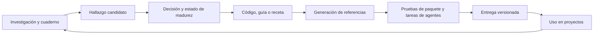

# Trama: estudio de identidad, evolución y uso por agentes

Fecha: 28 de octubre de 2026. Estado: propuesta para valorar; no constituye una decisión de producto ni una implementación.

**Resumen y mapa de lectura:** [resumen detallado del estudio completo](./resumen-estudio-trama-2026-10.md), preparado el 29 de octubre de 2026. Reúne este documento, el plan de referencias y el modelo de ejecución; cada bloque identifica sus archivos de procedencia. La sección 12 de este estudio detalla también los archivos fuente del consumidor y del repositorio de Trama.

## 1. Conclusión y recomendación

**Trama ya tiene gran parte de la materia prima para funcionar como una librería híbrida: componentes reutilizables y un sistema de conocimiento para construir sitios completos.** La evolución pendiente consiste en hacer ese conocimiento fácil de encontrar, aplicar, verificar y mantener desde otros proyectos.

La identidad pública se ha quedado atrás. ASCII y pixel art siguen siendo recursos distintivos, pero describen solo parte del producto. Las guías, recetas de sector, flujos de negocio, composición, movimiento y herramientas de investigación explican mejor su alcance actual.

Recomiendo avanzar por esta secuencia:

1. Alinear la descripción del producto y aclarar qué está disponible en cada versión y canal.
2. Preparar dos skills básicas de consumo —construir con Trama y aplicar sus guías de estilo— y una tercera para investigar referencias cuando el encargo lo requiera.
3. Distribuir referencias estructuradas, pequeñas y vinculadas a la versión instalada.
4. Evaluar resultados con tareas reales antes de ampliar la integración.
5. Añadir consultas por CLI y valorar MCP cuando exista una necesidad que las justifique.

La ventaja que merece desarrollar es **convertir investigación visual en decisiones de construcción reutilizables y comprobables**. Una skill que solo enumere componentes aprovecharía muy poco de lo que ya existe.

**Ampliación sobre referencias:** se ha añadido un [plan específico de investigación, inferencia y construcción](./plan-trama-investigacion-referencias.md), con valoración por tipo de entrada, ocho flujos, contratos de traspaso y evaluación. La recomendación es incorporar `trama-research` como capacidad opcional, conectada con las otras dos skills y con el laboratorio existente.

**Profundización del coste de ejecución:** el [estudio de tiempo, tokens e iteraciones](./estudio-costes-trama-agentes-2026-10.md) define objetivos verificables por tarea, niveles de validación y criterios para continuar, cambiar de método o cerrar. Sustituye la interpretación económica anterior. El [modelo editable](./modelo-costes-trama-2026-10.json) distingue antecedentes históricos, hipótesis de vueltas y mediciones pendientes; no predice aún tokens o duración por tarea.

## 2. Qué se ha revisado y hasta dónde llega el estudio

El workspace abierto es `martinezsebastian`, un consumidor de Trama. Por ello se han contrastado tres capas:

| Capa | Evidencia | Cómo se utiliza aquí |
| --- | --- | --- |
| Proyecto consumidor | `package.json`, documentación, ficha de Trama, artículo y capturas conservadas en este repo | Experiencia real de integración y comunicación externa |
| Distribución instalada | `node_modules/trama-ui`, versión **0.12.1**, procedente de `vendor/trama-ui-0.12.1.tgz` | Lo que recibe efectivamente este consumidor |
| Repositorio de Trama | Lectura pública de `main`, fijada al commit **`2263365bc6b9485028ae7ce769fcf1fb5ba619ec`**; su `package.json` declara **0.13.0** | Estado del código y conocimiento que todavía puede diferir de la distribución |

Del repositorio se ha revisado el árbol, el catálogo generado, el esquema y generador de catálogo, empaquetado, CLI, instrucciones para agentes, portada y navegación, estructura de guías y recetas, procedimientos de investigación y documentos recientes sobre guías e inspiraciones funcionales. Se han inspeccionado también implementaciones representativas, como `GuideFrame` y `BookingFlow`.

**Límites:** es una evaluación de producto, arquitectura y documentación. No se han ejecutado los 187 componentes, compilado el repositorio remoto ni reproducido sus pruebas. Los resultados de validación publicados en sus documentos se identifican como resultados declarados. Las capturas locales ilustran una versión anterior; el análisis de la portada actual se apoya además en su código. No se ha certificado qué commit está desplegado en la web ni qué versión está publicada actualmente en npm. La versión del repositorio no demuestra por sí sola la disponibilidad del paquete.

No se ha cambiado la web, instalado skills, publicado paquetes ni modificado el repositorio remoto. Este documento se guarda aquí para su valoración y posterior traslado al repositorio de Trama si se decide continuar.

## 3. Qué es Trama hoy

### 3.1 Inventario comprobado

El `docs/catalog.json` del commit estudiado contiene **187 entradas, 14 categorías, nueve variantes, ocho landings de referencia y 34 sitios de referencia**. Son entradas del catálogo, no una certificación de 187 APIs completas y estables. El árbol contiene 190 archivos TSX directamente en `components/ui/`; esos dos conteos no son equivalentes y su diferencia no demuestra un error. [Catálogo actual][catalogo]

| Capa del producto | Activos existentes | Valor para un agente |
| --- | --- | --- |
| Componentes y secciones | Formularios, navegación, contenido, precios, galerías, overlays, fondos y más | Evitar implementar de nuevo patrones ya resueltos |
| Sistema visual | Tokens, variantes, tipografías y `GuideFrame` | Mantener coherencia entre páginas |
| Guías de estilo | 19 guías documentadas; color, escala, espacio, superficies y movimiento | Traducir una dirección estética en decisiones concretas |
| Recetas por sector | Guía, orden de secciones, piezas, llamada principal y omisiones frecuentes | Resolver qué necesita el sitio de un negocio |
| Referencias completas | Landings, sitios y 18 inspiraciones | Aprender composición, navegación y flujos con contexto |
| Flujos de negocio | Reservas, compra, inscripción y solicitudes, entre otros | Acelerar interfaces de procesos completos |
| Motores y conceptos | Scroll, transiciones, 3D, efectos y técnicas extraídas de estudios | Construir experiencias particulares sin empezar desde cero |
| Laboratorio y cuaderno | Investigación, medición, comparación e historial | Convertir hallazgos en conocimiento reutilizable |
| Distribución | Paquete, CLI de assets/catálogo y exportación/retorno de código | Usar la librería instalada o adaptar piezas |

La estructura y finalidad de las guías están descritas en [la revisión de guías del repo][guias-doc]; las recetas viven en [sectores][sectores]; la evolución de las inspiraciones está registrada en [el plan funcional y su cierre][inspiraciones].

### 3.2 Fortalezas que conviene preservar

- **Existe un lenguaje común.** Tokens, `variant`, `intent`, superficies y reglas de composición reducen decisiones arbitrarias.
- **Hay conocimiento de diseño ejecutable.** Una guía contiene escala, espacio y movimiento, además de una paleta. `GuideFrame` aplica variables y clases. [Implementación de guías][guias]
- **Se estudian necesidades de negocio.** Una barbería, una academia y una tienda no se reducen al mismo hero con textos distintos. [Recetas sectoriales][sectores]
- **Ya hay un ciclo de aprendizaje.** Investigación, medición, reproducción, variación y extracción al kit están documentadas. Las propuestas de este estudio deben ampliar ese ciclo. [Procedimiento][procedimiento]
- **La separación entre kit y sitio está reconocida.** El empaquetado calcula dependencias y las instrucciones prohíben dependencias del kit hacia demos y catálogo. [Instrucciones][agentes], [empaquetado][paquete]
- **La experiencia de consumo devuelve mejoras.** En este proyecto se documentan problemas encontrados al usar Trama y adaptaciones fuera de Next.js; son material útil para futuras evaluaciones.

### 3.3 Brechas concretas

| Hallazgo | Evidencia | Consecuencia | Prioridad propuesta |
| --- | --- | --- | --- |
| Descripción centrada en el origen visual | README, descripción del paquete, metadata y hero siguen abriendo con ASCII/textmode/pixel art | El visitante puede no descubrir el sistema para sitios completos | Alta |
| Cifras y vocabulario divergentes | README: 72 componentes/siete estilos; hero: ocho; catálogo: 187 entradas/nueve variantes, incluida `editorial` | Personas y agentes reciben señales contradictorias | Alta |
| Conocimiento voluminoso | Catálogo Markdown: **229.396 bytes**; JSON: **621.170 bytes**, medidos sobre los archivos remotos | Leer todo antes de cada tarea consume contexto y dificulta seleccionar | Alta |
| Distribución del conocimiento incompleta | El empaquetador copia `CATALOG.md`, pero su lista de archivos no incluye `catalog.json`, skills ni hojas dedicadas de guías/recetas | El consumidor recibe menos capacidad de consulta que el repo | Alta |
| CLI de consulta muy limitada | Solo `assets` y `catalog`; este último devuelve la ruta del Markdown | Un agente debe buscar manualmente dentro de un documento grande | Media |
| Contrato orientado al playground | `PropSpec` modela texto, número, booleano y selectores; las firmas completas viven en TypeScript | Un control del visor no basta para describir callbacks, objetos y composición | Alta |
| Ejemplos ligados al repo | JSON contiene imports `@/components/ui/...`; el Markdown del paquete reescribe imports, pero las recetas siguen remitiendo a archivos del repo | Copiar una receta en otro proyecto puede requerir recursos ausentes | Alta |
| No hay skills distribuidas en el snapshot | No aparecen archivos `SKILL.md` en el árbol revisado | Las instrucciones internas no constituyen todavía una capacidad instalable | Alta |
| Interfaz funcional y servicio real pueden confundirse | `BookingFlow` guarda localmente; `onBooked` es un callback de integración | Una demo convincente puede tomarse por un sistema real de reservas | Alta |

Fuentes de la tabla: [README][readme], [portada][home], [metadata][layout], [catálogo][catalogo], [esquema][esquema], [generador][generador], [empaquetado][paquete], [CLI][cli] y [reserva][booking]. Los tamaños son bytes, no tokens ni tiempos de ejecución.

En este consumidor también hay deriva: su README menciona 0.12.0 y el paquete instalado es 0.12.1; el artículo afirma que se instala desde npm y otros documentos mantienen indicaciones de distribución local. Esto justifica verificar el canal real antes de actualizar promesas públicas.

## 4. Identidad y web: qué encaja y qué debería evolucionar

### 4.1 Identidad propuesta

Mantendría **Trama**. El nombre admite bien la relación entre piezas, sistemas visuales y relatos. No parece necesario un cambio de marca para ampliar su significado.

Propuesta de posicionamiento, pendiente de validar:

> **Trama reúne componentes, guías visuales y recetas para construir webs con carácter en React.**
> Para desarrolladores y agentes de IA, con composición, movimiento y patrones de negocio reutilizables.

La segunda frase debe presentarse como objetivo o acceso experimental hasta probar las skills. Next.js puede conservar un recorrido preferente y documentado; el soporte de otros entornos React debe expresarse por capacidades verificadas, especialmente fuentes y navegación.

### 4.2 Evaluación de la presentación actual

La identidad visual de la portada conserva valor: tipografía grande, negro/blanco/rojo y una escena característica hacen reconocible la marca. Las capturas locales muestran ese lenguaje y el código actual mantiene el planteamiento. El problema principal es **qué cuenta y en qué orden**.

Hoy la portada desarrolla componentes, landings, webs completas e instalación. Las guías tienen enlace en navegación, pero no un desarrollo equivalente en la portada; tampoco hay una entrada específica para agentes en la navegación revisada. [Portada][home], [navegación y tema][tema]

Propuesta de evolución:

| Elemento | Cambio sugerido | Qué permitiría comprobar |
| --- | --- | --- |
| Hero | Abrir con construir sitios y mostrar componentes + guías + recetas | Si se entiende el alcance en la primera pantalla |
| Prueba visual | Enseñar varias identidades completas, incluidas editorial, clara, comercial y experimental | Si Trama se percibe útil más allá de lo retro |
| Entrada de desarrollador | Instalar, seleccionar piezas y consultar APIs | Que sigue funcionando como librería convencional |
| Entrada de agente | Preparar contexto, seleccionar guía/receta y verificar resultado | Que la promesa corresponde a un flujo reproducible |
| Guías | Mostrar una guía aplicada a varias páginas y componentes | Que una guía modifica jerarquía, espacio y movimiento |
| Casos | Explicar piezas reutilizadas, adaptación y partes simuladas | Diferenciar demo, plantilla e integración de producción |
| Contadores y versiones | Generarlos desde fuentes comunes, con versión visible | Evitar otra divergencia entre portada y catálogo |

Posible navegación: **Empezar · Componentes · Guías · Recetas y sitios · Agentes**. El laboratorio puede conservar su función de investigación local; no todo su contenido tiene que convertirse en producto público.

No recomiendo sustituir toda la web ahora. Primero conviene ensayar el mensaje y un recorrido completo con una guía, una receta y un proyecto consumidor. Después se puede decidir la magnitud del rediseño.

## 5. Opciones para la evolución híbrida

Esfuerzos relativos, no estimaciones de calendario: S = intervención acotada; M = varias piezas coordinadas; L = infraestructura y mantenimiento continuos.

El [estudio del coste de ejecución](./estudio-costes-trama-agentes-2026-10.md) desarrolla cómo medir tiempo, tokens y vueltas hasta cumplir los objetivos. Las etiquetas S/M/L de esta tabla siguen siendo valoraciones relativas de implementación; no son tiempos de ejecución del agente.

| Opción | Incluye | Beneficio | Coste o limitación | Esfuerzo | Valoración |
| --- | --- | --- | --- | --- | --- |
| A. Documentación + `AGENTS.md` | Mejorar instrucciones e índice | Muy rápida y mantiene el uso manual | Descubrimiento y reutilización débiles fuera del repo | S | Base necesaria |
| B. Skills + referencias versionadas | Skills de construcción, estilo e investigación opcional; guías, recetas e índice consumibles | Portátil, auditable y usable sin servidor | Requiere resolver versión e instalación | M | **Primera entrega recomendada** |
| C. Skills + consultas CLI | B más búsqueda y consulta selectiva en JSON | Menos contexto y respuestas ajustadas al proyecto | Contrato y herramientas que mantener | M | Siguiente paso si mejora las pruebas |
| D. MCP | Exponer las mismas consultas como herramientas | Acceso desde agentes sin shell o con integración remota | Configuración, distribución y otro canal de compatibilidad | L | Condicional |
| E. Registro de componentes/plantillas | Distribución selectiva de código y recetas | Facilita copiar y adaptar | Gestionar dependencias, fusiones y divergencia con npm | L | Línea complementaria |
| F. Constructor integral | Generación/orquestación de sitios como producto | Experiencia más cerrada | Amplía mucho el alcance hacia editor, hosting e integraciones | L+ | Fuera del primer objetivo |

**B permite probar la hipótesis con una inversión contenida.** C aporta un mecanismo de consulta más eficiente. D debería reutilizar los datos y consultas de C para evitar dos implementaciones del mismo conocimiento.

Como referencia externa, shadcn combina una skill que obtiene contexto del proyecto con CLI y descubrimiento de componentes; también ofrece MCP para consultar registros. Es una demostración de complementariedad entre capas, no una razón para adoptar su stack o su modelo de copia. [Skills de shadcn](https://ui.shadcn.com/docs/skills), [MCP de shadcn](https://ui.shadcn.com/docs/mcp).

## 6. Diseño inicial de las skills

### 6.1 Tres capacidades de consumo, con límites claros

| Skill propuesta | Se activa cuando… | Debe producir | No debe asumir |
| --- | --- | --- | --- |
| `trama-build` | Se pide construir o modificar un sitio usando Trama | Composición basada en APIs disponibles, rutas, estados e integración explícita | Que hay acceso al repo de Trama, backend o publicación autorizada |
| `trama-style` | Se pide elegir, aplicar, adaptar o revisar una guía de Trama | Dirección visual coherente aplicada a tipografía, espacio, superficies y movimiento | Que todos los proyectos necesitan ASCII, 3D o la misma estructura |
| `trama-research` | Se pide investigar imágenes, webs o guías externas para construir o extraer una dirección visual | Evidencia, inferencias identificadas, brief aplicable y correspondencia con capacidades de la versión disponible | Que una captura revela interacción, código, fuentes exactas o reglas responsive; que investigar autoriza a ampliar la librería |

`trama-research` puede producir solo un estudio si ese es el encargo, o continuar hacia estilo y construcción si se ha pedido una web. No tiene que ejecutarse en cada tarea. El [plan de referencias](./plan-trama-investigacion-referencias.md) desarrolla sus entradas, salidas, modos y ocho recorridos posibles.

Una futura `trama-maintain` serviría para desarrollar la librería y promover aprendizajes del laboratorio. Conviene separarla: sus comandos, rutas e invariantes internas no corresponden al consumidor. Al principio bastaría con el `AGENTS.md` actual y referencias mantenidas.

No crearía una skill por componente ni una por guía. El índice puede describir todas las guías y cargar solo las elegidas. La especificación Agent Skills admite una carpeta con `SKILL.md` y recursos opcionales; conviene reservar el cuerpo para decisiones esenciales y abrir referencias según la tarea. [Especificación Agent Skills](https://agentskills.io/specification).

### 6.2 Flujo de construcción propuesto

1. **Detectar el proyecto:** versión instalada, framework, imports, CSS, fuentes, piezas copiadas y modificaciones locales.
2. **Interpretar el encargo:** público, contenido, páginas, acción principal y límites de integración. Usar el contexto disponible y preguntar solo por vacíos que condicionen la solución.
3. **Seleccionar conocimiento:** receta sectorial si encaja, guía visual y unos pocos ejemplos relevantes. Si hay referencias externas que interpretar, usar el brief de `trama-research`. Una receta orienta; el encargo puede justificar variaciones.
4. **Consultar el contrato real:** tipos públicos y referencia correspondiente a la versión. Buscar antes de crear y distinguir APIs internas de exports disponibles.
5. **Componer:** aprovechar secciones cuando resuelvan el caso y bajar a piezas para composiciones particulares. No convertir «secciones primero» en una obligación de producir siempre la misma landing.
6. **Completar el uso real:** textos propios, assets, rutas, errores, carga, vacío y confirmación; identificar qué depende de un servicio externo.
7. **Verificar y entregar:** comprobaciones del consumidor, revisión visual y recorrido principal; informar de lo comprobado y de las integraciones pendientes.

### 6.3 Flujo de estilo propuesto

Elegir una guía por su adecuación al encargo y las referencias, explicar brevemente la elección y aplicarla con la API de esa versión. Registrar las desviaciones que aporten identidad propia. Conservar la dirección elegida en páginas internas, formularios y estados.

La revisión debe comprobar jerarquía tipográfica, longitud de lectura, ritmo entre secciones, encuadres, contraste, interacción táctil, foco y movimiento reducido. Una puntuación de afinidad visual puede señalar desviaciones; no sustituye la revisión de diseño. El propio estudio de guías documenta limitaciones de su medida. [Guías y afinidad][guias-doc]

### 6.4 Compatibilidad: formato común, descubrimiento por entorno

| Entorno | Instalación inicial a validar | Base documental |
| --- | --- | --- |
| Codex local | `.agents/skills/<nombre>/SKILL.md` | [Documentación oficial de OpenAI](https://learn.chatgpt.com/docs/build-skills) |
| Claude Code local | `.claude/skills/<nombre>/SKILL.md` | [Documentación de Claude Code](https://code.claude.com/docs/en/skills) |
| VS Code/Copilot | Directorios nativos admitidos, como `.github/skills`, `.claude/skills` o `.agents/skills` | [Documentación de VS Code](https://code.visualstudio.com/docs/agent-customization/agent-skills) |
| Otros clientes | Adaptador y prueba explícita de descubrimiento, lectura y ejecución | Sin promesa universal inicial |

Compartir `SKILL.md` no garantiza idéntico descubrimiento, permisos, herramientas o comportamiento. Los entornos cloud requieren pruebas propias. La compatibilidad de formato y la calidad del resultado deben publicarse por separado.

Mantendría una sola fuente de las skills y generaría/copiaría el paquete completo para cada destino. Evitaría depender de symlinks como única vía, especialmente por Windows y portabilidad. Tampoco introduciría sintaxis dinámica exclusiva de un cliente en el cuerpo común.

La primera prueba debe usar instalación por proyecto y versión fijada. No sobrescribir instrucciones existentes ni instalar globalmente por defecto. El objetivo de distribución es un paso explícito y reproducible; los comandos exactos se decidirán al implementar.

## 7. Arquitectura del conocimiento y distribución

### 7.1 Fuentes de autoridad

| Información | Fuente existente o propuesta | Salidas derivadas |
| --- | --- | --- |
| API pública | Tipos y exports del paquete | Firmas, imports y ejemplos compilables |
| Descubrimiento de componentes | Metadatos de catálogo | Índice breve y fichas consultables |
| Diseño | `lib/ui/guides.ts`, reglas y excepciones | Hojas de guía humanas y datos para agentes |
| Composición por sector | `lib/catalog/sectores.ts` | Recetas con piezas y flujos |
| Investigación | Estudios y `docs/cuaderno/`; expedientes de referencias del proyecto consumidor | Evidencia, brief para construir y propuestas de promoción diferenciadas |
| Procedimiento de consumo | Skills | Instrucciones breves y adaptadores de instalación |

El catálogo actual ya se genera; conviene ampliarlo en vez de crear una base paralela mantenida a mano. Pero la generación desde el playground no debe presentar sus controles como la totalidad de la API. Propuesta: tipos para firmas, metadatos para uso y diseño, y comprobaciones entre ambos. [Esquema][esquema], [generación][generador]

### 7.2 Qué debería poder consultar un agente

- Índice de capacidades: qué resuelve cada pieza y cuándo conviene usarla.
- Componente: import público, firma o referencia de tipos, contenido obligatorio, ejemplos, dependencias, restricciones y alternativas.
- Guía: valores, fuentes y carga, composición, movimiento, reglas, excepciones y ejemplos.
- Receta: objetivo, páginas, secciones, piezas, estados e integraciones pendientes.
- Versión: paquete, esquema de datos, revisión de conocimiento, compatibilidad y procedencia.

Campos candidatos: `schemaVersion`, `packageVersion`, `sourceCommit`, `status`, `introducedIn`, `deprecatedIn`, `replacement`, `requires`, `examples` e `integration`. Añadirlos según necesidad comprobada, evitando catalogar información que nadie mantiene.

No marcaría toda la biblioteca «estable» de golpe. Cada capacidad necesita un estado verificable: experimental, disponible, obsoleta o interna. Los historiales extensos se cargan para investigar o migrar; el consumidor ordinario recibe la decisión vigente.

### 7.3 Empaquetado recomendado para el piloto

Mantener `trama-ui` como distribución principal e incluir referencias de agentes junto a la versión del código. Las tres skills pueden tener una fuente común en el repo y un mecanismo explícito de instalación en el consumidor. La investigación de webs puede usar un perfil adicional de herramientas; no debe obligar al consumidor básico a instalar todo el laboratorio de cine. La ubicación interna concreta queda por decidir tras comprobar herramientas y empaquetado.

Ventajas: una versión instalada identifica el código y el conocimiento disponible; se puede trabajar sin consultar `main`; no obliga a operar otro servicio. Un paquete separado de conocimiento solo merece la pena si las entregas editoriales necesitan un ritmo propio, y debe declarar exactamente qué versiones de Trama admite.

Las recetas que usan demos necesitan declarar si su código y assets se distribuyen o son solo referencia. Si prometemos «partir de esta web», debe existir una exportación utilizable con sus dependencias, rutas y recursos. Las fotos, modelos y vídeos del repo no se incluyen automáticamente en el paquete. [Documentación de distribución][docs], [empaquetador][paquete]

### 7.4 CLI y MCP: propuesta de contrato, todavía sin implementar

La CLI actual solo ofrece `assets` y `catalog`. Operaciones candidatas para una siguiente entrega:

| Operación conceptual | Entrada | Respuesta esperada |
| --- | --- | --- |
| Información de proyecto | Directorio de trabajo | Versión, framework, modo npm/copia y rutas resueltas |
| Buscar | Necesidad y filtros | Lista corta de capacidades y sus identificadores |
| Consultar pieza | Identificador | Contrato público y ejemplos de esa versión |
| Consultar guía | Identificador | Sistema visual y forma de aplicarlo |
| Consultar receta | Sector/objetivo | Composición y estados relevantes |
| Diagnosticar | Proyecto y comprobaciones seleccionadas | Hallazgos explicados, sin modificar archivos por defecto |

Estos nombres describen operaciones, **no comandos disponibles**. La implementación debe resolver la dependencia desde el proyecto objetivo, soportar instalaciones con `.tgz` y monorepos y no ejecutar siempre una versión remota más reciente. Debe funcionar con formatos de salida previsibles y errores claros.

Si llega MCP, puede envolver estas consultas y comenzar en lectura. Las operaciones que instalen o cambien archivos deberían ser herramientas diferenciadas y respetar la autorización del encargo. Un servidor remoto no debería devolver ejemplos incompatibles con el paquete instalado.

Un eventual `llms.txt` puede servir de índice de documentación pública; no garantiza descubrimiento por los clientes ni reemplaza skills, APIs o versionado. No aparece uno en el árbol del snapshot revisado.

## 8. Cómo mantener el sistema mientras Trama cambia

### 8.1 Ampliar el ciclo existente

El procedimiento actual ya exige extraer piezas, variar conceptos y comprobarlas fuera del caso original. La extensión propuesta es comprobar también que **otro agente puede descubrir y aplicar lo extraído en un consumidor limpio**. [Procedimiento][procedimiento], [plan de versatilidad][mejora]

No todo hallazgo del laboratorio debería convertirse inmediatamente en regla general. Antes de promoverlo: precisar qué resuelve, dónde se ha observado, qué límites tiene y qué cambia frente a la regla vigente. Una excepción de una web concreta puede quedarse en su receta.

### 8.2 Requisitos por tipo de cambio

| Cambio | Qué debe acompañarlo |
| --- | --- |
| Nueva prop o cambio de firma | Tipos, metadatos, ejemplo compilable y nota de compatibilidad |
| Pieza nueva | Caso resuelto, export público, dependencias, estados y ejemplo de consumo |
| Cambio de guía | Valores/reglas vigentes, referencias afectadas y revisión visual |
| Nueva receta | Piezas disponibles, estructura, flujo e identificación de simulaciones |
| Cambio de procedimiento | Actualización de la skill solo si cambia cómo debe decidir el agente |
| Hallazgo de investigación | Evidencia, hipótesis o decisión diferenciadas y ficha del cuaderno |
| Obsolescencia | Sustituto, versiones afectadas y migración cuando proceda |

Conviene añadir a la definición de terminado: catálogo regenerado, referencias sincronizadas y comprobación del paquete consumido. Que `catalog:check` pase no demuestra que el ejemplo funcione fuera del repo.

### 8.3 Política de versiones y actualizaciones

- En el piloto, fijar versiones exactas. Durante `0.x`, no asumir que una actualización menor conserva todos los contratos.
- Código y referencias deben compartir versión y procedencia; el formato de datos necesita su propia versión de esquema.
- Una skill instalada globalmente puede ser más nueva que el paquete: debe detectar la discrepancia y usar la referencia local compatible.
- Un proyecto existente conserva su guía y sus adaptaciones. Una guía nueva no debería rediseñarlo al actualizar la dependencia.
- Actualizar Trama y migrar una web son acciones distintas. Mostrar cambios y verificar antes de aplicar migraciones amplias.
- Para código copiado, registrar versión/commit de origen, archivos y personalizaciones. El retorno mediante `kit:pull` sigue requiriendo revisión del diff.
- El historial de investigación conserva contexto, mientras las referencias de consumo muestran la regla vigente y sus excepciones.

### 8.4 Verificaciones a incorporar progresivamente

1. Integridad de identificadores, exports, referencias y ejemplos.
2. Consumo del `.tgz` en un proyecto limpio, incluidas guías, CSS y fuentes.
3. Descubrimiento de las skills en cada entorno que se declare compatible.
4. Compilación y recorrido funcional de recetas representativas.
5. Revisión visual en móvil y escritorio, teclado y movimiento reducido.
6. Evaluación de tareas de agentes y repetición de casos afectados por cambios relevantes.

El repo ya dispone de `doctor`, `verify`, `smoke`, sondas y herramientas de cine. Deben reutilizarse donde corresponda. No hay que convertir todas las comprobaciones del laboratorio en requisitos para construir una página sencilla. [Flujo de trabajo actual][flujo]

## 9. Eficiencia: cómo averiguar si funciona mejor

Hoy no hay evidencia suficiente para afirmar cuánto tiempo o coste ahorra Trama a un agente. La amplitud del catálogo tampoco demuestra eficiencia. Se necesita comparar tareas bajo condiciones equivalentes.

### 9.1 Piloto propuesto

Comparar tres condiciones: agente con documentación actual; agente con skills y referencias; agente con skills y consulta selectiva por CLI cuando exista. Mantener modelo, encargo, versión de Trama, entorno y recursos constantes. Repetir las tareas, alternar el orden y revisar los resultados sin mostrar al evaluador qué condición produjo cada uno cuando sea posible.

| Tarea | Qué permite detectar |
| --- | --- |
| Landing editorial clara | Si el agente sale del sesgo retro y aplica una guía completa |
| Sitio de servicios con reserva | Si distingue interfaz, persistencia local y agenda real |
| Academia con páginas internas e inscripción | Si compone un flujo, no solo una portada |
| Tienda con carrito y estados | Si conserva coherencia y evita prometer pagos reales |
| Sitio de alto impacto con alternativa sin WebGL | Si el efecto mantiene contenido, accesibilidad y coste razonable |
| Cambio sobre un consumidor antiguo | Si respeta APIs disponibles y personalizaciones |
| Construcción desde una captura aislada | Si separa medidas aproximadas de hechos y resuelve lo que la imagen no muestra |
| Adaptación desde web, guía de marca y referencias contradictorias | Si conserva prioridades, procedencia y coherencia sin mezclar estilos arbitrariamente |

Añadir pruebas negativas: usar un componente fuera de Trama no debería activar mantenimiento del kit; trabajar con 0.12.1 no debería producir imports de 0.13.0; una petición sobria no debería recibir 3D por defecto.

### 9.2 Métricas y criterio de avance

| Dimensión | Qué registrar |
| --- | --- |
| Corrección | Imports/props inexistentes, errores de tipos y compilación |
| Funcionalidad | Recorrido principal, estados, enlaces y controles operativos |
| Diseño | Adecuación al brief, jerarquía, coherencia y calidad visual, con rúbrica humana |
| Accesibilidad | Teclado, foco, contraste, semántica y movimiento reducido |
| Rendimiento | JS/CSS transferidos y métricas de página en un dispositivo/condición definidos |
| Eficiencia del agente | Tiempo hasta resultado aceptado, contexto leído, tokens cuando estén disponibles y reintentos |
| Coste de validación | Vueltas hasta cumplir, duración por herramienta, regresiones y objetivos sin evidencia suficiente |
| Mantenimiento | Cambios necesarios al actualizar una pieza o guía |

Umbral inicial propuesto: los casos declarados compatibles deben compilar y completar su recorrido principal; no se aceptan APIs inventadas ni simulaciones presentadas como servicios reales. Comparar medianas y dispersión de tiempo/contexto, junto con calidad visual. No presentar una reducción de tiempo como mejora si empeoran funcionalidad o diseño.

Un primer lote de varias ejecuciones por caso sirve para encontrar fallos; no basta para una promesa comercial general de ahorro. Los objetivos porcentuales deberían fijarse después de medir la línea base.

Registrar la hipótesis, cambio y evidencia de cada vuelta. Comparar tareas con el mismo nivel de exigencia, incluir las que no terminan y medir el coste hasta cumplir, no solo hasta generar la primera versión. El [protocolo de ejecución](./estudio-costes-trama-agentes-2026-10.md) detalla perfiles V0–V3 y validación según el impacto del cambio.

## 10. Plan de trabajo por entregas

| Fase | Entrega concreta | Esfuerzo | Dependencia | Condición de cierre |
| --- | --- | --- | --- | --- |
| 0. Inventario y mensaje | Matriz repo/paquete/web; claims y conteos consistentes; límites de producción | S–M | Ninguna | Cada promesa tiene evidencia y canal disponible |
| 1. Contrato de conocimiento | Índice breve; ficha de componente, guía y receta; expediente de referencia y brief; versión/procedencia | M | 0 | Los casos piloto se resuelven sin cargar el catálogo entero y distinguen evidencia de inferencia |
| 2. Skills piloto | `trama-build` y `trama-style`; instalación local para Codex y Claude Code | M | 1 | Descubrimiento comprobado y primeras tareas aceptadas |
| 2b. Investigación piloto | `trama-research`: imagen, web y guía externa; traspaso a estilo/construcción | M | 1; integración con 2 | Tres entradas producen briefs útiles; una llega a sitio verificado; límites y supuestos quedan explícitos |
| 3. Evaluación | Línea base, registro de tiempo/tokens por vuelta y fallos, incluidas las tareas de referencias | M | 2 y 2b | Se conoce el coste hasta cumplir objetivos equivalentes y dónde se estancan las tareas |
| 4. CLI selectiva | Consulta y diagnóstico sobre la versión instalada | M | 1 y hallazgos de 3 | Reduce búsqueda/contexto sin empeorar los resultados |
| 5. Web y adopción | Recorridos de desarrollador/agente, guías y casos explicados | M | 0 y evidencia de 3 | Un usuario puede reproducir el recorrido documentado |
| 6. Extensiones | MCP, registro o plugins específicos | L | Necesidad demostrada | Resuelven una limitación observada del flujo anterior |

La corrección básica de textos puede hacerse desde la fase 0. La presentación pública de compatibilidad y eficiencia debe esperar a su validación. No es necesario detener la investigación actual para desarrollar este plan.

**Primera unidad de trabajo recomendada:** una receta sectorial, una guía y un proyecto consumidor limpio. Empaquetar el conocimiento mínimo, ejecutar el encargo con y sin skills, corregir los problemas y decidir después cuánto generalizar. Permite probar el sistema completo sin documentar de nuevo todo el catálogo.

**Extensión de esa unidad:** repetir el encargo desde una imagen, una web y una guía externa; comparar los briefs y construir al menos uno. El [plan de referencias](./plan-trama-investigacion-referencias.md) define los flujos y las condiciones de cierre. La investigación avanzada de 3D se incorpora después de validar esas entradas básicas.

## 11. Decisiones que quedan para valorar

| Decisión | Preferencia de este estudio | Alternativa razonable |
| --- | --- | --- |
| Identidad | Mantener Trama y ampliar su descripción | Revisar naming solo si pruebas con usuarios muestran confusión persistente |
| Público | Desarrolladores y agentes como recorridos complementarios | Especialización inicial en un perfil, conservando el otro |
| Distribución | Conocimiento junto al paquete y skills por proyecto | Paquete separado con compatibilidad explícita |
| Skills | Construcción, estilo e investigación opcional; mantenimiento separado | Unir investigación y estilo si el piloto demuestra que separarlas no aporta claridad |
| Referencias externas | Adaptar por defecto al encargo y documentar la intención; reproducción cuando se solicite | Investigación sin construcción o exploración de varias direcciones |
| Entornos | Probar primero Codex y Claude Code locales | Añadir Copilot y otros tras comprobar descubrimiento y comportamiento |
| Frameworks | Camino Next.js probado y límites explícitos para React genérico | Ampliar matrices de soporte según demanda |
| Consulta | Archivos selectivos primero; CLI después | Adelantar CLI si el volumen impide un piloto útil |
| MCP | Posponer hasta encontrar una necesidad concreta | Adelantarlo si el entorno objetivo carece de acceso a archivos/shell |
| Idioma | Guías con una fuente editorial y traducciones derivadas cuando aporten alcance | Piloto en español y evaluación bilingüe antes de duplicar contenido |

Estas preferencias son reversibles. No hace falta resolver hoy un marketplace, un constructor o una estrategia comercial para empezar a comprobar el valor de las skills.

## 12. Fuentes y trazabilidad

Todos los enlaces al código de Trama de este estudio apuntan al commit revisado, para que futuras investigaciones no cambien silenciosamente la evidencia.

### 12.1 Documentos que forman el estudio

Rutas relativas a este repositorio, `martinezsebastian`:

| Archivo | Información que contiene |
| --- | --- |
| [`docs/estudio-trama-hibrida-agentes-2026-10.md`](./estudio-trama-hibrida-agentes-2026-10.md) | Diagnóstico, identidad, alternativas, skills, arquitectura, mantenimiento, evaluación y fases |
| [`docs/plan-trama-investigacion-referencias.md`](./plan-trama-investigacion-referencias.md) | Modos de trabajo, ocho flujos F1–F8, herramientas, evidencia y contrato de traspaso |
| [`docs/estudio-costes-trama-agentes-2026-10.md`](./estudio-costes-trama-agentes-2026-10.md) | Objetivos, perfiles V0–V3, tiempo, tokens, correcciones, validación y protocolo experimental |
| [`docs/modelo-costes-trama-2026-10.json`](./modelo-costes-trama-2026-10.json) | Datos y supuestos editables: versiones, medidas, hipótesis, campos de registro y ejemplos aritméticos |
| [`docs/resumen-estudio-trama-2026-10.md`](./resumen-estudio-trama-2026-10.md) | Síntesis transversal y mapa de procedencia; documento derivado, sin mediciones nuevas |

### 12.2 Archivos del proyecto consumidor

Los archivos de esta tabla pertenecen a `martinezsebastian`, no al repositorio de Trama. Se concretan las rutas para localizar la evidencia local que el estudio describe. La ampliación del 29 de octubre organiza la trazabilidad y vuelve a comprobar la versión instalada; no repite la investigación remota ni la evaluación visual.

| Archivo o recurso local | Información que sustenta | Límite |
| --- | --- | --- |
| [`package.json`](../package.json) | Dependencia `trama-ui` mediante `file:vendor/trama-ui-0.12.1.tgz` | Declarar una dependencia no acredita todo su comportamiento |
| [`node_modules/trama-ui/package.json`](../node_modules/trama-ui/package.json) | Versión instalada 0.12.1, descripción, exports, tipos, CLI y archivos distribuidos | Archivo de instalación local; puede variar al reinstalar |
| [`node_modules/trama-ui/CATALOG.md`](../node_modules/trama-ui/CATALOG.md) | Catálogo que recibe el consumidor instalado | Corresponde al paquete local, no necesariamente al snapshot remoto |
| [`node_modules/trama-ui/bin/trama-ui.mjs`](../node_modules/trama-ui/bin/trama-ui.mjs) | Entrada de la CLI instalada | Su existencia no equivale a una prueba de ejecución |
| [`vendor/trama-ui-0.12.1.tgz`](../vendor/trama-ui-0.12.1.tgz) | Artefacto local del que procede la dependencia declarada | No demuestra publicación en npm |
| [`README.md`](../README.md), apartado `trama-ui` | Documentación del consumidor que todavía menciona 0.12.0 y distribución local | Evidencia de deriva documental respecto a la instalación |
| [`docs/arquitectura-ui-trama.md`](./arquitectura-ui-trama.md) | Integración híbrida, exportación/retorno de código y problemas encontrados al consumir Trama | Documento histórico; conserva instrucciones de versiones anteriores |
| [`src/lib/tools.ts`](../src/lib/tools.ts) | Ficha local de la herramienta Trama | Comunicación del consumidor, no inventario autoritativo de la API |
| [`content/blog/por-que-construi-trama.md`](../content/blog/por-que-construi-trama.md) | Relato público del producto y afirmaciones sobre instalación/uso | Un artículo no certifica disponibilidad del paquete |
| `public/herramientas/trama/01-inicio.jpg`, `public/herramientas/trama/02-catalogo.jpg`, `public/herramientas/trama/08-vigia.jpg` | Capturas históricas complementarias para la presentación visual | No acreditan el estado desplegado actual |

### 12.3 Archivos fuente del repositorio de Trama

Todas las rutas de esta tabla pertenecen a **`DanielMartinezSebastian/trama`**, commit **`2263365bc6b9485028ae7ce769fcf1fb5ba619ec`**. Los enlaces fijan esa revisión. Los conteos y las capacidades descritos son los recogidos por el estudio del 28 de octubre; esta ampliación no los actualiza a `main`.

| Archivo fuente | Información extraída o contrastada | Parte del estudio |
| --- | --- | --- |
| [`README.md`][readme] | Posicionamiento, cifras y presentación de la librería | Identidad y divergencias de comunicación |
| [`package.json`][pkg] | Versión declarada 0.13.0 y descripción del paquete | Separación repo/paquete instalado |
| [`docs/README.md`][docs] | Documentación y distribución del proyecto | Empaquetado y consumo |
| [`components/site/HomePage.tsx`][home] | Mensaje, estructura y contadores de portada | Evolución de la web |
| [`components/site/theme.ts`][tema] | Tema y navegación del sitio | Identidad visual y acceso a guías/agentes |
| [`app/layout.tsx`][layout] | Metadata pública | Coherencia del posicionamiento |
| [`docs/catalog.json`][catalogo] | Entradas, categorías, variantes, referencias, ejemplos y selección de fichas | Inventario, contexto y medida de bytes |
| [`lib/catalog/schema.ts`][esquema] | Esquema del catálogo y límites de `PropSpec` | Diferencia entre controles del visor y API completa |
| [`scripts/build-catalog.mts`][generador] | Generación de documentación y catálogo | Fuente común y referencias derivadas |
| [`scripts/build-package.mts`][paquete] | Archivos incluidos, dependencias y tratamiento de imports | Brechas de distribución del conocimiento |
| [`scripts/trama-cli.mjs`][cli] | Operaciones existentes `assets` y `catalog` | Base de la propuesta de CLI selectiva |
| [`lib/ui/guides.ts`][guias] | Modelo de guías, tokens y reglas visuales | Estilo y traducción de guías externas |
| [`components/ui/GuideFrame.tsx`][guideframe] | Aplicación de variables y clases de una guía | Diseño ejecutable y composición |
| [`lib/catalog/sectores.ts`][sectores] | Recetas y composición por sector | Construcción orientada al negocio |
| [`components/ui/BookingFlow.tsx`][booking] | Estado local y callback `onBooked` | Diferencia entre flujo de interfaz y servicio integrado |
| [`AGENTS.md`][agentes] | Instrucciones internas e invariantes del kit | Separación mantenimiento/consumo |
| [`docs/flujo-agentes.md`][flujo] | Procedimientos y herramientas de comprobación existentes | Reutilización de verificaciones |
| [`docs/35-procedimiento.md`][procedimiento] | Investigación, extracción, variación, ruido y revisión de estancamientos | Método de investigación y cierre |
| [`docs/36-plan-de-mejora.md`][mejora] | Versatilidad, objetivos y evaluación | Mantenimiento y calidad |
| [`docs/54-guias-de-estilo-del-repo.md`][guias-doc] | Revisión de guías y limitaciones de afinidad visual | Inventario visual y evaluación |
| [`docs/56-plan-inspiraciones-funcionales.md`][inspiraciones] | Evolución de inspiraciones y resultados declarados | Flujos y límites de la evidencia histórica |
| [`scripts/probe-refs.mts`][sonda] | Cabecera/contrato de la sonda de referencias | Ampliación de investigación web; no ejecutada en el estudio |
| [`docs/37-conceptos.md`][conceptos] | Conceptos y técnicas reutilizables | Investigación y promoción de aprendizajes |
| [`docs/16-guias-de-estilo-plan.md`][estudio-guias] | Planteamiento del sistema de guías | Traducción de referencias y reglas |
| [`docs/28-estudio-hublot-y-coste.md`][hublot] | Tiempos históricos de capturas, vueltas y sesiones | Modelo de costes; antecedentes declarados, sin reproducción independiente |

`components/ui/` y `docs/cuaderno/` son **directorios**, no archivos: el primero sirve para el inventario del árbol y el segundo para localizar el historial de investigación. La ausencia de `SKILL.md` y `llms.txt` es un hallazgo del árbol revisado, no información extraída de un archivo que exista con esos nombres. `CATALOG.md` designa también la salida de catálogo distribuida; no debe confundirse con `docs/catalog.json` ni con su generador.

Las recomendaciones de nuevas skills, fichas, campos de versión, CLI, MCP y fases son **propuestas elaboradas a partir de estas fuentes**, no funcionalidades cuya existencia acrediten esos archivos. Los ejemplos numéricos del modelo son ilustraciones aritméticas, salvo las medidas identificadas expresamente y los antecedentes históricos atribuidos.

### 12.4 Referencias externas y relación de fuentes original

Las páginas externas siguientes son las citadas por la investigación del 28 de octubre. Su inclusión aquí conserva la procedencia; no supone una nueva comprobación de compatibilidad o disponibilidad.

Además de las referencias de formato e integración enumeradas debajo, el plan de investigación cita [capturas de Playwright](https://playwright.dev/docs/screenshots), [comparación visual de Playwright](https://playwright.dev/docs/test-snapshots) y el [formato DTCG 2025.10](https://www.designtokens.org/tr/2025.10/format/). Son referencias para herramientas y posibles adaptadores, no pruebas de compatibilidad ya implementada en Trama.

- **Identidad y distribución:** [README][readme], [package.json][pkg], [documentación general][docs], [empaquetador][paquete] y [CLI][cli].
- **Web:** [portada][home], [tema y navegación][tema], [metadata][layout]. Capturas históricas complementarias: `public/herramientas/trama/01-inicio.jpg`, `02-catalogo.jpg` y `08-vigia.jpg` del workspace consumidor.
- **Contratos y conocimiento:** [catálogo JSON][catalogo], [esquema][esquema], [generador][generador], [guías][guias], [GuideFrame][guideframe], [recetas][sectores] y [BookingFlow][booking].
- **Evolución:** [instrucciones para agentes][agentes], [flujo de trabajo][flujo], [procedimiento de investigación][procedimiento], [plan de versatilidad][mejora], [guías del repo][guias-doc] y [cierre de inspiraciones funcionales][inspiraciones]. Este último declara revisión de 235 páginas y build de 907 páginas; no se han repetido aquí.
- **Compatibilidad externa, consultada el 28-10-2026:** [Agent Skills](https://agentskills.io/specification), [OpenAI](https://learn.chatgpt.com/docs/build-skills), [Claude Code](https://code.claude.com/docs/en/skills), [VS Code](https://code.visualstudio.com/docs/agent-customization/agent-skills).
- **Referencia de integración:** [skills de shadcn](https://ui.shadcn.com/docs/skills) y [MCP de shadcn](https://ui.shadcn.com/docs/mcp).

[readme]: https://github.com/DanielMartinezSebastian/trama/blob/2263365bc6b9485028ae7ce769fcf1fb5ba619ec/README.md
[pkg]: https://github.com/DanielMartinezSebastian/trama/blob/2263365bc6b9485028ae7ce769fcf1fb5ba619ec/package.json
[docs]: https://github.com/DanielMartinezSebastian/trama/blob/2263365bc6b9485028ae7ce769fcf1fb5ba619ec/docs/README.md
[home]: https://github.com/DanielMartinezSebastian/trama/blob/2263365bc6b9485028ae7ce769fcf1fb5ba619ec/components/site/HomePage.tsx
[tema]: https://github.com/DanielMartinezSebastian/trama/blob/2263365bc6b9485028ae7ce769fcf1fb5ba619ec/components/site/theme.ts
[layout]: https://github.com/DanielMartinezSebastian/trama/blob/2263365bc6b9485028ae7ce769fcf1fb5ba619ec/app/layout.tsx
[catalogo]: https://github.com/DanielMartinezSebastian/trama/blob/2263365bc6b9485028ae7ce769fcf1fb5ba619ec/docs/catalog.json
[esquema]: https://github.com/DanielMartinezSebastian/trama/blob/2263365bc6b9485028ae7ce769fcf1fb5ba619ec/lib/catalog/schema.ts
[generador]: https://github.com/DanielMartinezSebastian/trama/blob/2263365bc6b9485028ae7ce769fcf1fb5ba619ec/scripts/build-catalog.mts
[paquete]: https://github.com/DanielMartinezSebastian/trama/blob/2263365bc6b9485028ae7ce769fcf1fb5ba619ec/scripts/build-package.mts
[cli]: https://github.com/DanielMartinezSebastian/trama/blob/2263365bc6b9485028ae7ce769fcf1fb5ba619ec/scripts/trama-cli.mjs
[guias]: https://github.com/DanielMartinezSebastian/trama/blob/2263365bc6b9485028ae7ce769fcf1fb5ba619ec/lib/ui/guides.ts
[guideframe]: https://github.com/DanielMartinezSebastian/trama/blob/2263365bc6b9485028ae7ce769fcf1fb5ba619ec/components/ui/GuideFrame.tsx
[sectores]: https://github.com/DanielMartinezSebastian/trama/blob/2263365bc6b9485028ae7ce769fcf1fb5ba619ec/lib/catalog/sectores.ts
[booking]: https://github.com/DanielMartinezSebastian/trama/blob/2263365bc6b9485028ae7ce769fcf1fb5ba619ec/components/ui/BookingFlow.tsx
[agentes]: https://github.com/DanielMartinezSebastian/trama/blob/2263365bc6b9485028ae7ce769fcf1fb5ba619ec/AGENTS.md
[flujo]: https://github.com/DanielMartinezSebastian/trama/blob/2263365bc6b9485028ae7ce769fcf1fb5ba619ec/docs/flujo-agentes.md
[procedimiento]: https://github.com/DanielMartinezSebastian/trama/blob/2263365bc6b9485028ae7ce769fcf1fb5ba619ec/docs/35-procedimiento.md
[mejora]: https://github.com/DanielMartinezSebastian/trama/blob/2263365bc6b9485028ae7ce769fcf1fb5ba619ec/docs/36-plan-de-mejora.md
[guias-doc]: https://github.com/DanielMartinezSebastian/trama/blob/2263365bc6b9485028ae7ce769fcf1fb5ba619ec/docs/54-guias-de-estilo-del-repo.md
[inspiraciones]: https://github.com/DanielMartinezSebastian/trama/blob/2263365bc6b9485028ae7ce769fcf1fb5ba619ec/docs/56-plan-inspiraciones-funcionales.md
[sonda]: https://github.com/DanielMartinezSebastian/trama/blob/2263365bc6b9485028ae7ce769fcf1fb5ba619ec/scripts/probe-refs.mts
[conceptos]: https://github.com/DanielMartinezSebastian/trama/blob/2263365bc6b9485028ae7ce769fcf1fb5ba619ec/docs/37-conceptos.md
[estudio-guias]: https://github.com/DanielMartinezSebastian/trama/blob/2263365bc6b9485028ae7ce769fcf1fb5ba619ec/docs/16-guias-de-estilo-plan.md
[hublot]: https://github.com/DanielMartinezSebastian/trama/blob/2263365bc6b9485028ae7ce769fcf1fb5ba619ec/docs/28-estudio-hublot-y-coste.md
