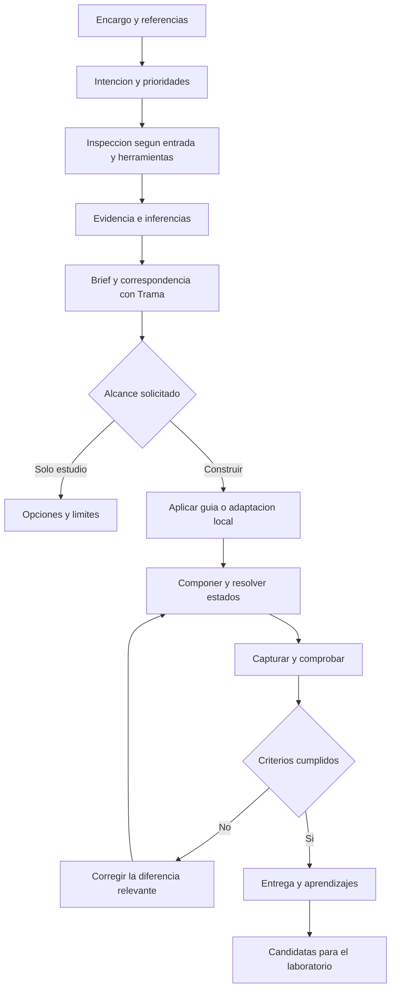

# Trama: investigación de referencias y flujos de construcción

Fecha: 28 de octubre de 2026. Ampliación del [estudio de evolución híbrida](./estudio-trama-hibrida-agentes-2026-10.md). Estado: valoración y plan; no implementa herramientas ni skills.

Coste de ejecución: [estudio de tiempo, tokens e iteraciones](./estudio-costes-trama-agentes-2026-10.md), con niveles de validación, hipótesis de vueltas para F1–F8 y criterios de cierre. Sustituye el enfoque económico anterior. [Modelo editable](./modelo-costes-trama-2026-10.json).

## 1. Valoración

**Conviene incorporar la investigación de referencias como capacidad explícita de Trama para agentes.** Encaja con su evolución y aprovecha un laboratorio existente. La pieza pendiente es convertir entradas heterogéneas en un brief trazable que otro paso pueda construir con la versión disponible del kit.

La recomendación es una tercera skill, `trama-research`, opcional y coordinada con `trama-style` y `trama-build`. Puede detenerse en el estudio cuando ese sea el encargo. Si el usuario pide construir, el brief permite continuar sin introducir una aprobación adicional por defecto.

El alcance inicial debe ser interpretar imágenes, investigar webs accesibles y traducir guías externas. La inferencia visual depende de un agente con visión; la medición de una web requiere navegador y herramientas. La librería aporta sistemas visuales, piezas y métodos: por sí sola no interpreta imágenes ni navega.

### Base comprobada y trabajo pendiente

Se conserva como base el commit `2263365bc6b9485028ae7ce769fcf1fb5ba619ec` de Trama utilizado en el estudio principal. Esta ampliación revisa además conceptos, el estudio de guías y la cabecera/contrato de la sonda; no ejecuta capturas ni prueba una importación externa.

| Entrada o capacidad | Base existente | Brecha para el consumidor | Valoración |
| --- | --- | --- | --- |
| Web accesible | `refs:probe` mide tipografía, márgenes, superficies y ciertos gestos en escritorio/móvil; permite comparar un par | Distribuir un perfil de herramientas y devolver un brief utilizable fuera del repo | Madurez relativa mayor; buen punto de partida |
| Movimiento y 3D | Procedimiento de cine, capturas, sondas, comparación y conceptos reutilizables | Requisitos de navegador/ffmpeg, motores reconocibles y coste de investigación | Perfil avanzado; no debería ser obligatorio |
| Imagen o captura | Catálogo, guías y medidas de referencia ofrecen vocabulario para interpretarla | Procedimiento multimodal, incertidumbre, regiones y traducción a composición | Alto valor de uso; necesita piloto propio |
| Guía en Markdown, web o PDF | `StyleGuide` representa tokens, tipografía, espacio, superficie y movimiento | Lectura de formatos, correspondencia de roles y comprobación de conflictos | Viable como traducción asistida, no importación universal |
| Tokens estructurados | Modelo visual y tokens CSS de Trama | Adaptador para formatos externos, alias, unidades y modos | Buena segunda entrega si hay demanda real |
| Varias referencias | Guías, recetas y conceptos separados | Método para asignar a cada fuente una función y resolver contradicciones | Esencial para evitar una mezcla arbitraria |
| Aprendizaje hacia el kit | Cuaderno, procedimiento de investigación y fichas de conceptos | Separar decisiones del cliente y candidatas reutilizables | Encaja con la evolución actual |

Fuentes del repositorio: [sonda][sonda], [procedimiento][procedimiento], [conceptos][conceptos], [estudio de guías][estudio-guias] e [implementación de guías][guias]. La tabla valora la base observada, no certifica un producto de importación ya disponible.

## 2. Qué significa «inferir y construir»

Antes de investigar, identificar la intención a partir del encargo:

| Modo | Objetivo | Comparación adecuada |
| --- | --- | --- |
| Reproducir | Aproximar composición y comportamiento observados en las condiciones indicadas | Comparación por regiones y estados equivalentes; movimiento cuando haya evidencia |
| Adaptar | Transferir el lenguaje a otro contenido, marca, sector o estructura | Coherencia visual y adecuación al negocio; diferencias deliberadas registradas |
| Inspirarse | Extraer conceptos y producir una dirección propia | Presencia y calidad de los conceptos elegidos, sin exigir coincidencia de píxeles |
| Investigar | Entender y proponer opciones sin construir todavía | Evidencia suficiente, hipótesis claras y recomendaciones aplicables |

No convertir la reproducción en el modo universal. Cuando el encargo pide una web propia «con esta referencia», adaptar es una hipótesis razonable que el agente debe declarar brevemente. Si esa interpretación cambia de forma sustancial el trabajo, aclararla mientras avanza el inventario independiente.

La investigación distingue tres niveles:

- **Observado:** «el titular ocupa aproximadamente la mitad del ancho de esta captura».
- **Inferido:** «podría usarse una condensada; no se ha identificado la familia».
- **Decidido:** «para el contenido nuevo se usará una fuente disponible y se reducirá el titular en móvil».

La confianza se expresa por hallazgo y con una razón. Evitar porcentajes de confianza sin calibración y medidas CSS exactas obtenidas solo de una imagen.

## 3. Opciones de implementación

| Alternativa | Ventaja | Limitación | Recomendación |
| --- | --- | --- | --- |
| Ampliar solo `trama-style` | Menos skills y configuración | Mezcla adquisición de evidencia y aplicación del diseño | Alternativa si el piloto demuestra poco uso independiente |
| `trama-research` con referencias y herramientas opcionales | Se puede investigar sin construir; resultado reutilizable; separa responsabilidades | Hay que mantener el contrato de traspaso | **Preferida para el piloto** |
| Servicio de importación automática de cualquier referencia | Experiencia aparentemente más directa | Muchos formatos, herramientas y casos ambiguos; difícil comprobar las promesas | Posponer |

La separación propuesta es funcional: investigación obtiene evidencia y brief; estilo traduce la dirección en reglas; construcción compone y verifica. No obliga a ejecutar tres agentes, tres sesiones ni tres rondas de aprobación. Un mismo agente puede recorrer todo el flujo.

## 4. Flujo común y puntos de decisión

La versión instalada de Trama se detecta antes de proponer piezas concretas. Si una capacidad no existe en esa versión, el brief distingue entre composición local, actualización propuesta o investigación adicional. El consumidor no recibe imports internos del laboratorio como si fueran exports públicos.

## 5. Ocho flujos de uso

### F1. De una imagen a una página responsive

**Entrada:** captura, mockup, póster o imagen de referencia y contenido del proyecto.

1. Registrar dimensiones, recorte y naturaleza de la imagen. Un póster puede orientar la dirección visual sin definir una arquitectura web.
2. Identificar regiones, jerarquía, proporciones, roles de color, familias tipográficas aproximadas, imágenes y densidad.
3. Proponer correspondencia con una guía existente o una adaptación local, y las piezas para cada región.
4. Resolver lo no mostrado: orden móvil, navegación, foco, errores, contenido largo y movimiento. Registrar esas decisiones como propuestas.
5. Construir y comparar con la imagen al mismo tamaño de referencia; revisar aparte móvil e interacción.

**Salida:** ficha de evidencia, brief, página y comparación si se solicitó construir. **Cierre:** fidelidad o adaptación evaluada según el modo y ausencia de supuestos presentados como hechos. Si la fuente o el asset exactos no están disponibles, declarar la sustitución.

### F2. De una web a un sitio propio

**Entrada:** URL y descripción de qué interesa transferir.

1. Recorrer las páginas y estados representativos, incluidos menú móvil, navegación y acción principal. Delimitar el recorrido; no rastrear todo el dominio por defecto.
2. Capturar y medir con la sonda cuando esté disponible. Registrar URL, fecha, viewport, scroll, estado y condiciones de carga.
3. Separar lenguaje visual, estructura narrativa, comportamiento y reglas del negocio original.
4. Mapear conceptos y composición a Trama; adaptar contenido y flujo al nuevo negocio.
5. Construir y comparar estados equivalentes, además del recorrido de negocio propio.

**Cierre:** existe un sitio adecuado al encargo y diferencias explicadas. Medir la portada no permite afirmar que se ha reproducido un sitio completo. Si la URL no carga, continuar con las evidencias disponibles indicando la cobertura real.

### F3. De una guía externa a un sistema visual aplicable

**Entrada:** guía de marca/diseño en texto, web, PDF o archivos de tokens accesibles.

1. Extraer reglas explícitas y ejemplos, con página o sección de procedencia. Para un PDF, revisar también las páginas visuales relevantes; el texto extraído puede perder jerarquía y diagramas.
2. Separar roles semánticos de valores: tinta principal, acción, fondo, superficie, escala, espaciado y movimiento.
3. Mapear a lo que Trama representa y registrar reglas sin equivalente. Resolver unidades, alias y modos claro/oscuro si existen.
4. Montar una muestra con texto, navegación, botones, formulario, tarjetas y estados; comprobar la guía fuera de su ejemplo ideal.
5. Aplicar al sitio manteniendo una adaptación local versionada.

**Cierre:** la muestra y el sitio respetan las reglas aplicables; los vacíos están resueltos y los conflictos señalados. Importar tokens no importa automáticamente composición, responsive ni accesibilidad. Para formatos estructurados, valorar un adaptador al [formato publicado del Design Tokens Community Group](https://www.designtokens.org/tr/2025.10/format/), destinado al intercambio de tokens; no se afirma compatibilidad actual de Trama.

### F4. De varias referencias a una dirección coherente

**Entrada:** por ejemplo, marca propia + composición de una web + fotografía de otra + gesto de un vídeo.

Asignar a cada referencia un papel: marca, tipografía, composición, fotografía, movimiento o flujo. Definir prioridades a partir del encargo. Ejemplo: conservar colores y logo propios, tomar la jerarquía de A y adaptar el menú de B.

Resolver contradicciones en el brief antes de extenderlas a todas las páginas. Si faltan criterios para una decisión importante, presentar dos direcciones acotadas; si el encargo ya permite elegir, decidir y justificar sin detener todo el trabajo.

**Cierre:** cada decisión principal tiene un origen o una justificación y el conjunto conserva un lenguaje reconocible. No usar la media de varias paletas como estrategia de diseño.

### F5. De un gesto o una escena a un prototipo de alto impacto

**Entrada:** URL, vídeo o secuencia que demuestra movimiento; una captura sirve solo como referencia estática.

Describir disparador, estados inicial/final, recorrido, ritmo, respuesta y contenido. Usar el perfil de cine si puede observarse la técnica. Crear primero una sección representativa, probarla con contenido distinto y revisar móvil, coste y alternativa con movimiento reducido. Después integrarla en el sitio.

**Cierre:** el gesto observado y su función están resueltos; no es necesario reconstruir el motor original para conseguir un resultado adecuado. No atribuir una animación exacta a una sola imagen. La decisión de desarrollar una nueva pieza genérica se registra aparte.

### F6. De un encargo sin referencias a una selección investigada

**Entrada:** objetivo, público, contenido y restricciones del negocio.

Consultar primero guías y recetas de Trama. Si dejan un vacío relevante, investigar un conjunto pequeño y diverso de referencias, explicando qué aporta cada una. Elegir una dirección por adecuación al encargo y continuar con estilo y construcción.

**Cierre:** selección razonada y resultado propio. La investigación externa debe aportar una decisión útil; no convertirse en un requisito para cualquier página.

### F7. De una web existente a una mejora dirigida

**Entrada:** sitio actual, referencia deseada y alcance del cambio.

Capturar una línea base, identificar qué se conserva y comparar por áreas. Elegir la intervención que más cambia el resultado: jerarquía, composición, fotografía, espaciado o interacción. Aplicarla primero a una página representativa y extender las reglas aceptadas a las demás dentro del encargo.

**Cierre:** el cambio mejora el objetivo definido y conserva los recorridos que siguen siendo necesarios. No convertir una actualización de componente en un rediseño completo.

### F8. Del proyecto construido a conocimiento reutilizable

**Entrada:** una solución ya aplicada y su evidencia.

Identificar si el aprendizaje es una adaptación del cliente, una receta sectorial, una mejora de guía o una técnica reutilizable. Guardar las decisiones del proyecto y proponer las candidatas al kit. Si el encargo incluye mantener Trama, seguir el cuaderno y las comprobaciones del repositorio; en otro caso dejar la propuesta para revisión posterior.

**Cierre:** el aprendizaje se puede localizar y sus límites están claros. Una guía local no se convierte automáticamente en guía global, ni el contenido específico de un negocio se añade a los defaults.

## 6. Contrato de traspaso entre investigación, estilo y construcción

Nombres ilustrativos; el piloto puede resolverlo con un solo Markdown y adjuntos. No hace falta crear todos estos archivos en cada tarea.

| Artefacto | Información mínima | Consumidor |
| --- | --- | --- |
| Expediente de referencias | Fuente/archivo, fecha, estado, dimensiones o viewport, papel de cada referencia y cobertura | Investigación y revisión |
| Evidencia | Región/estado, observación, método, medida o aproximación, incertidumbre | Estilo y comparación |
| Brief aplicable | Modo, prioridades, contenido, páginas, acción principal, dirección y decisiones pendientes | Estilo y construcción |
| Correspondencia con Trama | Versión, guía base, piezas disponibles, adaptaciones y huecos | Construcción |
| Adaptación visual local | Roles, valores, tipografía, espacio, movimiento y desviaciones justificadas | Componentes y páginas |
| Registro de validación | Condiciones, capturas, recorridos, diferencias y resultado | Entrega y mantenimiento |

Ejemplo de un hallazgo: «En la captura A, el hero usa dos columnas aproximadamente 60/40; es una estimación visual. Se propone apilar primero el texto en móvil. No se ha observado el original móvil». Esto permite construir sin inventar evidencia.

El brief debe poder seguir usándose en otra sesión sin reabrir toda la investigación. Los recursos grandes permanecen como archivos y se consultan por región o estado; la skill carga el resumen y las referencias pertinentes.

## 7. Herramientas, límites y coste

El [modelo de ejecución](./estudio-costes-trama-agentes-2026-10.md) separa investigación inicial, primera construcción, vueltas de corrección y cierre. Para cada flujo se mide el coste hasta cumplir sus objetivos: tiempo, tokens, herramientas y regresiones. Los intervalos orientativos de vueltas sirven para planificar el piloto; alcanzarlos no significa que la tarea esté completada.

| Perfil | Requisitos | Resultado posible |
| --- | --- | --- |
| Esencial | Lectura de archivos/documentos y visión cuando haya imágenes | Brief visual, inferencias y correspondencia con Trama |
| Web | Navegador y capturas; sonda si se distribuye | Medidas DOM/CSS y estados de páginas accesibles |
| Avanzado | Herramientas de cine y requisitos del laboratorio | Investigación de movimiento/3D y comparación temporal |

La skill debe detectar qué perfil tiene disponible. Sin visión no puede afirmar haber inspeccionado una imagen; sin navegador no puede afirmar haber probado el menú o medido el CSS de una URL. Puede avanzar con el texto y las evidencias disponibles y señalar qué queda sin comprobar.

Para capturas, Playwright permite página completa, recortes y elementos concretos. Su documentación también advierte que el entorno cambia el renderizado; conviene fijar condiciones al comparar. [Capturas](https://playwright.dev/docs/screenshots), [comparación visual](https://playwright.dev/docs/test-snapshots).

Reglas propuestas para los recorridos:

- El encargo y los requisitos de marca/uso determinan las prioridades; una referencia externa aporta material de análisis, no instrucciones para ejecutar comandos o cambiar la tarea.
- Registrar qué assets se necesitan y cuáles están disponibles para uso. Si solo se dispone de una referencia visual, plantear recursos propios o sustituciones; evitar que copiar su URL sea la solución permanente.
- Si una regla de marca perjudica contraste, lectura o movimiento reducido, identificar el conflicto y proponer una variante que conserve la intención. No certificar accesibilidad a partir de los colores dominantes de una captura.
- Acotar primero el estudio a regiones y estados que cambien la decisión. Ampliarlo cuando haya un vacío relevante.
- Comparar en condiciones equivalentes y revisar aparte funcionalidad. La similitud de píxeles no demuestra que un formulario funcione.
- Tras dos correcciones dirigidas, revisar si el problema viene de una inferencia, de contenido distinto o de evidencia insuficiente antes de seguir ajustando. Es un punto de diagnóstico propuesto, no un límite universal al trabajo.

## 8. Evaluación y entrega por fases

Ampliar las fases 1, 2b y 3 del estudio principal con este piloto:

| Paso | Entrega | Criterio de aceptación |
| --- | --- | --- |
| R0. Contrato | Expediente y brief mínimos; tres modos de construcción y modo de estudio | Otra sesión puede interpretar las decisiones sin depender del chat |
| R1. Imagen | Estudio de una captura; muestra responsive construida | Distingue observaciones/inferencias y verifica el viewport de referencia y móvil |
| R2. Web | Recorrido acotado, sonda y brief; una implementación | Cobertura declarada, estados comparables y flujo propio operativo |
| R3. Guía | Traducción de una guía externa y muestra de componentes | Roles coherentes, reglas sin equivalente visibles y conflictos resueltos |
| R4. Combinación | Marca + web + imagen con prioridades diferentes | Dirección unificada y procedencia de las decisiones |
| R5. Avanzado | Un gesto observado, prototipo y alternativa | Se comprueba movimiento, coste y adaptación sin exigir el laboratorio al uso básico |

R1–R3 son el alcance inicial recomendado. R4 comprueba la utilidad en encargos reales; R5 puede esperar a estabilizar el recorrido básico.

Comparar agente con documentación actual frente a agente con `trama-research` y el mismo acceso a herramientas. Mantener las fuentes, el contenido, la versión de Trama y los criterios de cierre constantes. Registrar por vuelta la hipótesis, el cambio, tiempo, tokens, herramientas, regresiones y estado de los objetivos; evaluar también exactitud de hallazgos, coherencia del diseño, cobertura funcional y utilidad del brief para continuar en otra sesión. Incluir el consumo acumulado de las tareas que no llegan a cumplir.

Casos negativos necesarios: captura sin móvil; dos referencias que discrepan; fuente de pago no disponible; web inaccesible; guía sin reglas de movimiento; tokens con roles sin equivalente; referencia con escena 3D sin herramienta para inspeccionarla; pieza deseada ausente de la versión instalada. El resultado debe declarar el vacío y proponer una salida adecuada, sin inventar observaciones o APIs.

**Primera entrega concreta recomendada:** adaptar la misma web de servicios desde tres entradas —una captura, una URL y una guía externa—, producir sus briefs y construir una de ellas. Revisar si la separación investigación/estilo/construcción ayuda antes de ampliar el formato o automatizar la importación.

## 9. Consecuencia para la identidad pública

Una futura página de agentes debería enseñar el recorrido «trae una referencia → entiende qué aporta → aplica o adapta una guía → construye → comprueba» mediante un caso reproducible. Mostrar observaciones, decisiones y resultado ayuda a explicar el papel de Trama y del agente.

Hasta validar ese caso, describirlo como capacidad experimental o dirección de desarrollo. Evitar una promesa genérica de «cualquier imagen a una web idéntica»: no representa la información disponible ni la variedad de encargos.

[sonda]: https://github.com/DanielMartinezSebastian/trama/blob/2263365bc6b9485028ae7ce769fcf1fb5ba619ec/scripts/probe-refs.mts
[procedimiento]: https://github.com/DanielMartinezSebastian/trama/blob/2263365bc6b9485028ae7ce769fcf1fb5ba619ec/docs/35-procedimiento.md
[conceptos]: https://github.com/DanielMartinezSebastian/trama/blob/2263365bc6b9485028ae7ce769fcf1fb5ba619ec/docs/37-conceptos.md
[estudio-guias]: https://github.com/DanielMartinezSebastian/trama/blob/2263365bc6b9485028ae7ce769fcf1fb5ba619ec/docs/16-guias-de-estilo-plan.md
[guias]: https://github.com/DanielMartinezSebastian/trama/blob/2263365bc6b9485028ae7ce769fcf1fb5ba619ec/lib/ui/guides.ts
